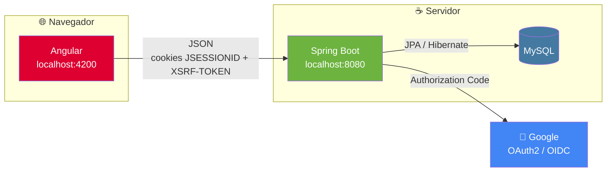
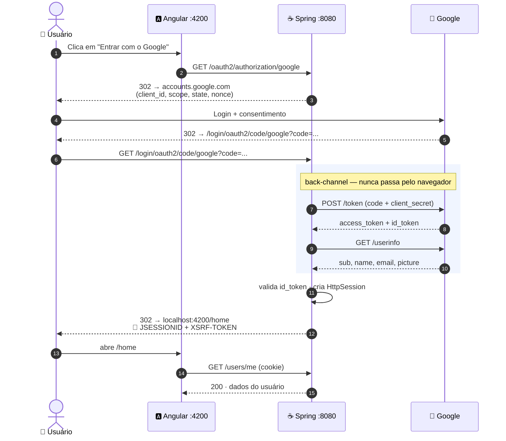
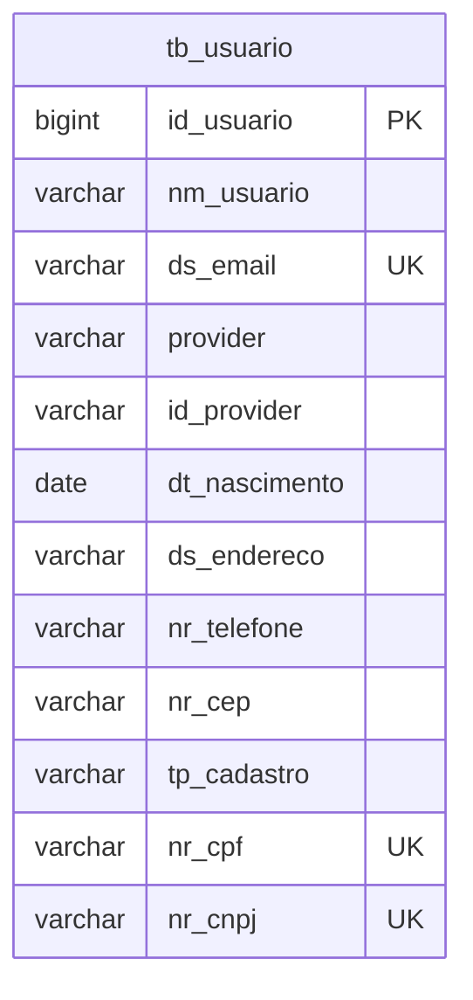

<div align="center">

# 💰 Finsy

**Controle financeiro para pessoas físicas e pequenos negócios**

Envie uma foto, o Finsy organiza. Pergunte, o Finsy responde.

[](https://openjdk.org/)
[](https://spring.io/projects/spring-boot)
[](https://spring.io/projects/spring-security)
[](https://angular.dev/)
[](https://getbootstrap.com/)
[](https://www.mysql.com/)
[]()
[]()

</div>

---

> [!NOTE]
> **Status do projeto:** já funcionam a landing page, o login com Google, o painel (home) e o formulário de perfil (ainda sem salvar).
> Dashboard com IA, leitor de imagens e chatbot financeiro ainda são apenas cards de apresentação na home.

## 📑 Sumário

- [O que é o Finsy](#-o-que-é-o-finsy)
- [Tecnologias](#-tecnologias)
- [Arquitetura](#-arquitetura)
- [Como rodar](#-como-rodar)
- [Fluxo de autenticação](#-fluxo-de-autenticação)
- [Segurança](#-segurança)
- [Endpoints da API](#-endpoints-da-api)
- [Modelo de dados](#-modelo-de-dados)
- [Estrutura do projeto](#-estrutura-do-projeto)
- [Convenção de nomes](#-convenção-de-nomes)
- [Pontos de atenção](#-pontos-de-atenção)
- [Roadmap](#-roadmap)

---

## 🧭 O que é o Finsy

A maior parte dos apps financeiros falha no primeiro passo: alguém precisa digitar cada gasto, um por um, até desistir.

O Finsy propõe o caminho contrário — você **envia uma foto** de uma nota ou comprovante, o app **lê e organiza** o lançamento sozinho, e você **conversa** com ele para entender para onde o dinheiro está indo.

| Ferramenta | O que faz |
|---|---|
| 📊 **Dashboard com avisos da IA** | Gastos por categoria e período, com alertas quando algo foge do padrão |
| 📷 **Leitor de imagens** | Foto ou print de nota/comprovante vira lançamento automático (valor, data, estabelecimento) |
| 💬 **Agente de IA** | Perguntas em português simples sobre o próprio histórico financeiro |

## 🛠 Tecnologias

<table>
<tr>
<td valign="top" width="50%">

**Backend**
- Java 21 · Spring Boot 4.1.1
- Spring Security 7 + OAuth2 Client
- Spring Data JPA / Hibernate
- Postgres
- Lombok

</td>
<td valign="top" width="50%">

**Frontend**
- Angular 17+ (standalone components)
- Signals, guards e interceptors funcionais
- Reactive Forms
- Bootstrap 5.3 + Bootstrap Icons (CDN)
- Google Fonts — Fraunces & Inter

</td>
</tr>
</table>

## 🏗 Arquitetura



Front (`:4200`) e API (`:8080`) são **origens diferentes**. Por isso existe CORS explícito no backend, e o Angular envia `withCredentials: true` em toda requisição para os cookies viajarem.

## 🚀 Como rodar

### Pré-requisitos

`Java 21` · `Node.js LTS` + `Angular CLI` · `MySQL` · uma conta Google

### 1️⃣ Credenciais do Google

1. No [Google Cloud Console](https://console.cloud.google.com/), configure a **Tela de consentimento OAuth**.
2. Em **Credenciais → Criar credenciais → ID do cliente OAuth**, escolha **Aplicativo da Web**.
3. Em **URIs de redirecionamento autorizados**, adicione:
   ```
   http://localhost:8080/login/oauth2/code/google
   ```
4. Copie o `client-id` e o `client-secret`.

### 2️⃣ Backend

```bash
cp application_example.properties src/main/resources/application.properties
# preencha datasource, client-id/secret e app.frontend-url
./mvnw spring-boot:run
```
📍 sobe em `http://localhost:8080`

### 3️⃣ Frontend

```bash
npm install
ng serve
```
📍 sobe em `http://localhost:4200` — acesse por **localhost**, não `127.0.0.1` (o CORS e os cookies exigem o mesmo host configurado)

> [!TIP]
> Backend e frontend ficam em repositórios separados (`FINSY-BackEnd` e `FINSY-FrontEnd`). Os dois precisam estar rodando ao mesmo tempo.

## 🔐 Fluxo de autenticação

Login social via **Google, Authorization Code Flow** (o backend é um cliente confidencial — guarda o `client-secret` no servidor, então PKCE não é necessário; quem troca o `code` pelo token é sempre o Spring, nunca o navegador).



**Depois do login, o Google sai de cena.** Toda requisição seguinte (`GET /users/me`, por exemplo) é resolvida só com a **sessão**, sem nova chamada ao Google.

| Token | Emitido por | Duração | Usado quando |
|---|---|---|---|
| `access_token` | Google | ~1h | Uma vez, para consultar o `userinfo` durante o login |
| `id_token` | Google | ~1h | Uma vez, para o Spring validar a identidade |
| `JSESSIONID` | Spring | 30 min de inatividade | Em **toda** requisição, para manter o usuário logado |

Não há `refresh_token` (o Finsy não pede `access_type=offline`) nem JWT trafegando para o Angular — o frontend só conhece o cookie de sessão.

## 🛡 Segurança

| Camada | Como é feita |
|---|---|
| **Sessão** | Cookie `JSESSIONID`, `HttpOnly` (JS não lê), `SameSite=Lax`, expira em 30 min |
| **CSRF** | `csrf.spa()` — cookie `XSRF-TOKEN` legível pelo JS, devolvido no header `X-XSRF-TOKEN` pelo `csrfInterceptor` do Angular em todo `POST`/`PUT`/`DELETE` |
| **CORS** | Só `app.frontend-url` é aceito, com `allowCredentials`, para o cookie poder viajar entre `:4200` e `:8080` |
| **Sem sessão** | `401 Unauthorized` (não um redirect para o Google) |
| **Falha no login** | Redirect para `/?error=login`, exibido como aviso na landing |
| **Dado duplicado** (e-mail/CPF/CNPJ) | `409 Conflict` |
| **Banco indisponível** | `503 Service Unavailable` |

> [!IMPORTANT]
> Nunca versione `application.properties` com credenciais reais. Use `application_example.properties` como modelo.

## 📡 Endpoints da API

Base: `http://localhost:8080`

| Método | Rota | Acesso | Descrição |
|---|---|---|---|
| `GET` | `/oauth2/authorization/google` | Público | Inicia o login |
| `GET` | `/login/oauth2/code/google` | Público | Callback do Google |
| `GET` | `/users/me` | 🔒 Sessão | Usuário logado (cria no 1º acesso) |
| `POST` | `/logout` | 🔒 Sessão + CSRF | Encerra a sessão |

<details>
<summary><b>Exemplo de resposta — <code>GET /users/me</code></b></summary>

```json
{
  "id": 1,
  "name": "Maria Souza",
  "email": "maria@gmail.com",
  "provider": "google",
  "providerId": "109283746501928374650",
  "pictureUrl": "https://lh3.googleusercontent.com/a/..."
}
```

</details>

## 🗄 Modelo de dados



`UK(provider, id_provider)` — identidade real do usuário no login social.

## 📁 Estrutura do projeto

<table>
<tr>
<td valign="top">

**Backend**
```
config/
 ├─ CorsConfig.java
 └─ SecurityConfig.java
controller/
 ├─ UserController.java
 └─ GlobalExceptionHandler.java
domain/
 ├─ User.java
 └─ PersonType.java
dto/
 └─ UserResponseDTO.java
repository/
 └─ UserRepository.java
service/
 └─ UserService.java
```

</td>
<td valign="top">

**Frontend**
```
core/
 ├─ guards/auth.guard.ts
 ├─ interceptors/
 │   ├─ credentials.interceptor.ts
 │   └─ csrf.interceptor.ts
 ├─ models/user.model.ts
 └─ services/
     ├─ auth.service.ts
     └─ user.service.ts
features/
 ├─ landing/
 ├─ home/
 └─ profile/
shared/components/
 ├─ header/
 └─ feature-card/
```

</td>
</tr>
</table>

## 🔤 Convenção de nomes

- **Código em inglês** — classes, métodos, variáveis, rotas, JSON.
- **Interface em português** — tudo que o usuário lê.
- **Banco em português** — `tb_usuario`, `nm_usuario`... A ponte é feita pelo `@Column(name = "...")`, sem depender de migração.

## ⚠️ Pontos de atenção

- **Sessão em memória** — reiniciar o backend desloga todos os usuários.
- **Formulário de perfil ainda não salva** — falta `PUT /users/me`.
- **Sem testes automatizados** ainda.
- **CORS/CSRF** foram pensados para `localhost`; em produção, revisar `SameSite`/`Secure` conforme domínio final.

## 🗺 Roadmap

- [ ] `PUT /users/me` com validação de CPF/CNPJ
- [ ] Dashboard com gráficos e avisos da IA
- [ ] Leitor de imagens de notas e comprovantes
- [ ] Agente de IA para perguntas sobre gastos
- [ ] Testes automatizados (backend e frontend)

---

<div align="center">

Feito para organizar sua vida financeira. 💚

</div>
